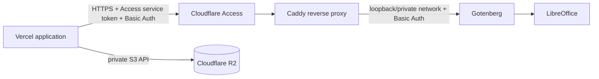

# Private document renderer operations

Align renders generated DOCX documents through an independently deployed Gotenberg service. The renderer is stateless: PostgreSQL owns workflow state and private R2 objects hold immutable PDF/PNG results. It is not part of the Vercel application process and must never expose an unauthenticated conversion endpoint.

## Current deployment status and production gate

Local Docker Compose rendering is implemented and verified. The production hostname is `https://align-pdf-renderer.vyndra.tech`, protected by Cloudflare Access, but it is not considered application-verified until the credentialed smoke test and real end-to-end conversion gates below pass. Keep `DOCUMENT_RENDERER_ENABLED=false` in Vercel until every gate succeeds. When it is false, document generation fails closed before publication; the rest of Align remains available.

Oracle Cloud Always Free is a feasible £0 candidate, not guaranteed capacity or an operational commitment. Align has no paid fallback. If a suitable instance cannot be obtained and retained at £0, production document generation remains disabled while local development and validation continue.

## Tested image, fonts, and compatibility

The renderer image is built from the real-render-tested base:

```text
gotenberg/gotenberg:8.38.1-libreoffice@sha256:2098722190575dbd975d8abf02e4ce83ffe20783114c5cc56f1b2ac309e6a083
```

`docker/gotenberg/Dockerfile` installs and verifies the four template fonts: Arial, Georgia, Trebuchet MS, and Times New Roman. Those Microsoft Core Fonts are accepted through their installer EULA during the image build; do not redistribute the font files separately. A production registry image must be built from this Dockerfile, tested, pushed, and pinned by its own registry digest. `GOTENBERG_IMAGE_DIGEST` records the tested base digest expected by the application and deployment checks.

LibreOffice pagination can differ from Microsoft Word because their layout engines, font metrics, line breaking, table handling, and compatibility rules are not identical. Align's authoritative page count is therefore the count from the verified PDF created by this exact renderer, not a DOCX estimate or a Microsoft Word preview.

## Topology and access control



- Vercel must use only `https://align-pdf-renderer.vyndra.tech`.
- Protect that hostname with a Cloudflare Access service-auth policy. Create a dedicated service token for Align; do not use a user token or a token shared with another application.
- Put Caddy in front of Gotenberg for TLS termination, request-size/rate controls, and a second Basic Auth boundary. Gotenberg also retains its own API Basic Auth configuration.
- Bind Gotenberg to loopback or a private Docker network; expose only Caddy's ports 80/443 through the cloud firewall/NSG. Port 3000 must not be internet-accessible.
- Vercel uses dynamic egress addresses on the current deployment tier, so an IP allow-list is not a sufficient or generally feasible primary control. Authentication and TLS are mandatory; an allow-list may be added only when stable egress is separately provided.
- Use unique high-entropy Basic Auth and Cloudflare Access credentials. Store them only in Vercel encrypted variables and their respective origin/Cloudflare secret stores. Perform secret rotation by accepting a new credential, updating Vercel, smoke testing, then removing the old credential.
- Never use a `NEXT_PUBLIC_` renderer variable. Never log credentials, document bytes, extracted text, CV content, or signed object URLs.
- Disable Gotenberg's `downloadFrom` and debug routes, and do not enable Chromium or other conversion modules that Align does not use. The only application conversion path is the authenticated LibreOffice form route.

The server-only application variables are:

| Variable | Production rule |
| --- | --- |
| `DOCUMENT_RENDERER_ENABLED` | Set `true` only after all gates pass; otherwise `false` |
| `GOTENBERG_URL` | Exact value `https://align-pdf-renderer.vyndra.tech` |
| `GOTENBERG_USERNAME` | Unique server-only Basic Auth identity |
| `GOTENBERG_PASSWORD` | High-entropy server-only secret |
| `CF_ACCESS_CLIENT_ID` | Client ID from Cloudflare Zero Trust → Access → Service Auth → Service Tokens |
| `CF_ACCESS_CLIENT_SECRET` | Matching service-token secret, shown by Cloudflare only when the token is created |
| `GOTENBERG_EXPECTED_VERSION` | `8.38.1` |
| `GOTENBERG_IMAGE_DIGEST` | Tested base digest shown above |

These are the exact eight Vercel variables required for remote production rendering. `DOCUMENT_RENDERER_ENABLED` is the application gate; `GOTENBERG_URL` is the fixed hostname above; the renderer deployment operator supplies the Basic Auth username/password from the Caddy/Gotenberg configuration; Cloudflare Zero Trust supplies the service-token ID/secret; the expected version and image digest are pinned by this repository. Configure them for the Vercel environments that render documents (Production, and Preview only if preview deployments are intentionally allowed). None may use a `NEXT_PUBLIC_` prefix.

## Resource and request bounds

The absolute starting allocation is **1 vCPU and 2 GiB RAM**. For a small ARM production VM, prefer 2 OCPU and 4–6 GiB when free allocation permits. Run one renderer replica with one active conversion and queue size 4. Reject excess work instead of allowing unbounded memory growth. Limit the request body to 10 MiB at Caddy and Gotenberg.

Timeouts are layered deliberately:

- Gotenberg conversion: 45 seconds.
- Application renderer request: 50 seconds.
- Complete generation workflow: 260 seconds.
- Vercel function `maxDuration`: 300 seconds.

The complete workflow permits one workflow-scoped retry, not a retry per layout attempt. A stable workflow idempotency key and the database publication lock prevent duplicate usage charges, duplicate artifact writes, or publication after an interrupted request. Never retry validation failures. Retry only a transient renderer/network failure while the workflow deadline and retry budget remain.

## Local deployment and smoke test

Docker Desktop or a compatible Docker Engine must be running. The local compose service binds the protected endpoint only to `127.0.0.1:3001`.

```bash
docker compose build gotenberg
docker compose up -d --wait db redis minio gotenberg
```

Configure a local shell or ignored `.env.local`:

```dotenv
DOCUMENT_RENDERER_ENABLED=true
GOTENBERG_URL=http://127.0.0.1:3001
GOTENBERG_USERNAME=align-renderer
GOTENBERG_PASSWORD=local-renderer-change-me
GOTENBERG_EXPECTED_VERSION=8.38.1
```

Do not set `CF_ACCESS_CLIENT_ID` or `CF_ACCESS_CLIENT_SECRET` for this loopback/Docker configuration. The application requires the pair only when the configured renderer is remote.

Then run:

```bash
npm run check:renderer
```

The check proves unauthenticated access is denied, health and LibreOffice are up, the version/digest contract matches, and all four templates render a safe synthetic one-page sample with the required fonts and preserved text. It never sends user data.

## £0 production candidate: Oracle Cloud Always Free

Oracle documents an Always Free aggregate allowance for Ampere A1 Compute in the tenancy home region, commonly configured as a `VM.Standard.A1.Flex` instance. A conservative candidate is 2 OCPU and 12 GiB RAM, leaving headroom within the published aggregate allowance. This is not a hosting guarantee:

- creation can fail with **out of host capacity**, especially in a constrained home region;
- idle reclamation can remove an under-used instance;
- account verification and payment-card checks may be required even for free resources;
- limits, eligibility, and programme terms can change and must be rechecked before deployment.

Do not select a paid shape, boot volume, load balancer, reserved public IP, support plan, or egress service. Set a budget alert at £0 where the provider permits it. There is no paid fallback authorised for Align.

### Provision and secure

1. In the tenancy home region, attempt to create Ubuntu LTS on `VM.Standard.A1.Flex` with 2 OCPU and 12 GiB, using only resources explicitly marked Always Free. Stop if the console shows any non-zero forecast.
2. Create an NSG/firewall allowing inbound SSH only from the operator's current address and inbound 80/443 for Caddy. Deny inbound Gotenberg port 3000. Apply unattended security updates.
3. Create an unprivileged deployment user, install Docker Engine and the Compose plugin, and disable password SSH login after key access is confirmed.
4. Point `align-pdf-renderer.vyndra.tech` to the instance through proxied Cloudflare DNS. Configure Caddy to obtain and renew TLS, enforce the body/rate limits, require Basic Auth, and proxy to the Docker-private Gotenberg service. Create a Cloudflare Access service-auth application and policy for the hostname.
5. Clone or copy the exact release, build `docker/gotenberg/Dockerfile`, run the local smoke check from the VM network, push the custom image to a private registry if the host will not build releases, and pin the tested custom image digest in Compose.
6. Create a dedicated Cloudflare Access service token and immediately store its ID and one-time-visible secret in Vercel as `CF_ACCESS_CLIENT_ID` and `CF_ACCESS_CLIENT_SECRET`. Set all eight server-only renderer variables in Vercel. Run `npm run check:renderer` from a network path equivalent to production; the check crosses Cloudflare Access with the service token and confirms that omitting Basic Auth still receives 401.
7. Only after a real end-to-end generation stores private artifacts and returns an ownership-scoped preview may `DOCUMENT_RENDERER_ENABLED=true` be deployed.

If capacity, stable availability, DNS, TLS, authentication, or the smoke checks cannot be verified, leave the flag false and report the outstanding dependency. Do not substitute an open public conversion service.

## Monitoring and recovery

Probe the authenticated `/health` endpoint every minute without document content. Alert after two consecutive failures. Collect host/container metrics and structured application events for status, trace id, duration, attempt, page count, and stable error code only—**without PII**.

Alert on:

- any OOM kill or container restart;
- memory above 85%, disk above 80%, or sustained CPU saturation;
- queue depth 3–4, queue rejection/HTTP 429, or a queue that does not drain;
- p95 conversion latency above 10 seconds for 10 minutes;
- conversion failures above 5% for 10 minutes;
- repeated authentication failures, certificate renewal failure, or health/version mismatch.

On OOM or repeated LibreOffice failure, disable generation first, preserve metadata-only logs, restart the renderer, and run `npm run check:renderer`. For queue saturation, let clients receive the recoverable busy state and investigate load; do not raise concurrency past the measured memory limit. For latency or conversion failures, check host pressure and the exact image/version before retrying.

Application failure states remain distinct: conversion failure, page-limit failure, and thumbnail failure are recoverable independently. A conversion or page-limit failure can never publish a CV as validated. Thumbnail failure may retain the verified PDF and be retried under its own lock. If approved content cannot fit within two actually rendered pages after bounded readable layouts, generation returns a controlled page-limit failure without truncation, deletion, or artificial stretching.

## Rollback and cost

The renderer is stateless. Roll back by setting `DOCUMENT_RENDERER_ENABLED=false`, then restore the last real-render-tested custom image digest and rerun the smoke check. Do not mutate existing immutable artifacts during rollback. The application serves every verified PDF and PNG from private R2 through authenticated, ownership-scoped routes; account deletion removes the owning prefix.

Expected renderer hosting cost is £0 only while the selected compute, storage, DNS choice, registry, and traffic stay within verified free allowances. Vercel, R2, provider, and domain usage have their own existing limits and are not made free by this design. Recheck provider billing dashboards and terms before enabling production; any non-zero required renderer cost is a launch blocker under the present budget.
